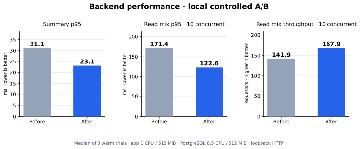

# Backend performance — November 5, 2026

The final local comparison reduced handover-summary query events from **16 to 11**.
At ten concurrent read requests, median trial throughput increased from
**141.9 to 167.9 requests/s**, while median trial p95 fell from **171.4 to 122.6 ms**.
These results describe the warm, constrained experiment below.

Original business code:
[`8c851c0`](https://github.com/AtaKaanSavasci/shift-handover-system/tree/8c851c0529198ed6aea44e5c9db97771f003932c).
The baseline adds only the same opt-in instrumentation used by the updated app
([`b2e3b98`](https://github.com/AtaKaanSavasci/shift-handover-system/tree/b2e3b98da25456081e219086710b985d3a70b46d)).
Final application/schema source:
[`61d2f6b`](https://github.com/AtaKaanSavasci/shift-handover-system/tree/61d2f6b).

## Changes

- Optional `PERFORMANCE_LOGGING=true` emits one JSON record per API response:
  route template, status, completion, elapsed time, Prisma query-event count/time,
  connection-pool snapshot and process RSS. It excludes raw URLs, SQL, parameters,
  authentication headers and user content. There is no public metrics endpoint.
- Six bounded summary preview queries now use one SQL statement, returning at
  most 33 public preview rows. Each panel retains its filter, priority/date/ID
  order and limit. The existing transaction, acknowledgment and revision behavior
  remain intact; operational responses retain `no-store`.
- A partial index orders open tasks, valves and attention items by priority,
  creation time and ID. Historical notes and closed work are outside the index.
- Each application instance admits one multipart entry request and one Excel
  build at a time, in separate slots. Excess requests receive HTTP 503 and
  `Retry-After: 3` before buffering uploads or fetching export rows. Slots stay
  occupied until work settles, including after a client disconnect. Text-only
  entries use JSON and bypass upload admission. Turkish/English busy messages
  preserve drafts/photos for explicit retry.

No dependency was added. Migration `20261105000100_open_board_order` is required:
run `npx prisma migrate deploy` before starting the updated backend.

## Conditions and method

Both applications used **Node 22.23.4**, the same image/dependencies, production
mode and **1 CPU / 512 MiB** limits. PostgreSQL **17.11** shared **0.5 CPU / 512 MiB**
between two databases. The baseline database retained the original eight
migrations; the updated database was cloned from that exact seeded snapshot and
then received the ninth migration. The baseline could not use the new index.
The shared executor had a two-CPU parent quota and 8 GiB memory limit.

Each database initially contained ten synthetic users, 3,010 shifts, 10,000
entries, 120 open board items, 3,000 progress notes, 300 work changes and 500
synthetic photos. No real team data, credentials or AI calls were used.
Both servers passed readiness checks and 30 warm-up reads. Their summary JSON
was deeply equal before timing. Transport was loopback HTTP without TLS or a CDN.

The read mix equally weights `/operations/summary`, `/shifts/current` and
`/operations/entries?view=open&page=1`. Three trials alternate variant order;
summary trials issue 50 serial requests, and read-mix trials run for eight seconds
at concurrency one or ten without think time. Latency covers dispatch through
reading the complete body. Throughput includes draining outstanding requests.
Concurrent requests are not concurrent human users.

Normal polling separately models ten staggered sessions, each issuing three reads
every 30 seconds: 60 requests over 60 seconds per variant. Query timing and the
same additional one-second runtime sampler were enabled for both applications.
Production request logging remains disabled by default.

## Results

Except for normal polling, values are medians of three trial statistics, not
pooled percentiles. Brackets show the observed range of trial p95 values.

| Metric | Before | After |
| --- | ---: | ---: |
| Summary query events per request | 16 | 11 |
| Summary p95 | 31.11 ms [23.01–45.38] | 23.10 ms [16.27–24.84] |
| Read mix, concurrency 1: throughput | 131.44 req/s | 151.46 req/s |
| Read mix, concurrency 1: p95 | 16.55 ms [16.43–18.17] | 13.57 ms [12.25–13.73] |
| Read mix, concurrency 10: throughput | 141.88 req/s | 167.91 req/s |
| Read mix, concurrency 10: p95 | 171.36 ms [169.14–179.48] | 122.62 ms [120.47–134.81] |
| Normal ten-session polling: p95, one run | 40.14 ms | 27.88 ms |

The final **14,637 scored read requests** all returned HTTP 200 without transport
errors. The concurrency-ten comparison represents **18.3% more throughput** and
**28.4% lower p95** in these conditions. Query counts fell **31.25%**, observed in
150 instrumented summary responses per variant. Median summed Prisma query-event
duration for those responses fell from 9.90 to 7.71 ms. This sum includes driver
and round-trip work; it is not PostgreSQL execution time alone.

Admission checks issued three simultaneous requests per operation:

| Operation | Before | After |
| --- | --- | --- |
| Photo entry | 3 × 201 | 1 × 201, 2 × 503 |
| Excel export of 3,010 shifts | 3 × 200 | 1 × 200, 2 × 503 |

There were no transport errors in these checks. The updated behavior deliberately
admits less simultaneous heavy work and asks the other callers to retry. These
tiny samples do not establish heavy-operation throughput or a production p95.

## Why the index was necessary

The first batched-query comparison reduced round trips but regressed at concurrency
ten: median throughput was 146.58→137.05 req/s and p95 166.61→178.99 ms. Its plan
still scanned the entry table for the ordered open-items preview. That initial
run is retained in the reproduction package rather than counted as a final result.

A separate SQL experiment used five warm-ups and 15 `EXPLAIN (ANALYZE, BUFFERS)`
samples per candidate. The unindexed batched statement had median execution time
2.471 ms and 450 shared-buffer hits. With the partial ordering index, these were
0.123 ms and 39 hits. A shared-ID CTE was also measured but was slower than the
indexed statement. These SQL-only figures are distinct from the HTTP results.

The final index occupied 16 KiB for the initial 120 open items. A final plan used
index scans for the preview branches, and PostgreSQL index statistics confirmed
use during the workload. Index maintenance adds write work; its isolated write
cost was not measured. The final API comparison was rerun using separate cloned
databases after selecting the index.

## Validation and limits

- Build, typecheck, Prisma schema validation and migration deployment passed.
  `prisma migrate diff` reported no schema difference after the migration.
- **60/60 unit/API tests** and **23/23 PostgreSQL integration tests** passed again
  after adding the index. New coverage includes concurrent timing isolation,
  privacy, pool disposal, bounded/tied panel ordering and repeatable-read behavior,
  admission before parsing, failure recovery and disconnect handling.
- All **70/70 Chromium tests** across 15 isolated suites passed on the application
  code before the index-only follow-up. The **23 database-backed browser cases**
  were repeated successfully after the migration. New browser cases check JSON
  text submissions and Turkish/English busy-upload retry with retained drafts.
- The production high-severity audit gate passed; npm reported zero findings at
  the time of the check. Dependency versions were unchanged.
- GitHub Actions was not yet verified when this report was written. Windows,
  physical phones, Safari, public-network latency, cold starts, sustained memory
  behavior and larger datasets were not measured here. CPU quotas and shared-host
  scheduling affect these small samples; they do not establish field percentiles.

Pool counts and process-wide RSS are response-time snapshots, not per-request
allocation or peak-memory measurements. The sampler can miss short peaks. Limits
apply to one application process and do not coordinate multiple replicas.

See the [measurement summary](backend-performance-2026-11-05/summary.json) and
[reproduction package](backend-performance-2026-11-05/measurement-package.zip) for
raw samples, logs, plans, initial-run corrections and scripts. Runtime behavior is
documented in the [application guide](../application-guide.md#optional-backend-timings).
